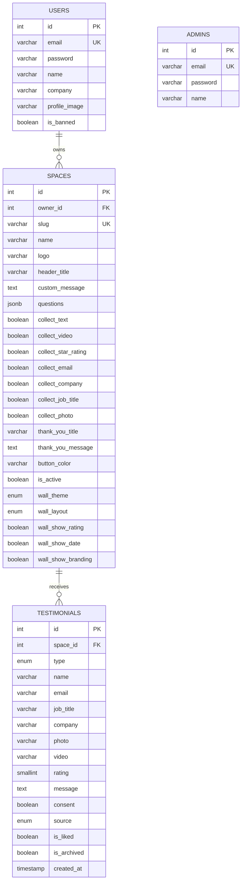

# Data Model

```
users (1) ────< spaces (1) ────< testimonials
admins (separate, no relation)
```



## Relationships and rules
- A user owns many spaces; deleting the user deletes their spaces (`ON DELETE CASCADE`).
- A space has many testimonials; deleting the space deletes them (`ON DELETE CASCADE`).
- `spaces.slug` is unique and is the public URL part (`/s/:slug`, `/w/:slug`).
- `testimonials.type`: `text` or `video`. `source`: `collected` (public form) or `imported` (added by owner).
- Wall = testimonials where `is_liked = true` and `is_archived = false`. Archiving sets `is_liked = false`.
- `testimonials.email` is private and never returned by public endpoints.
- Full column details: `database/schema.sql` and `docs/SRS.md` section 6.
